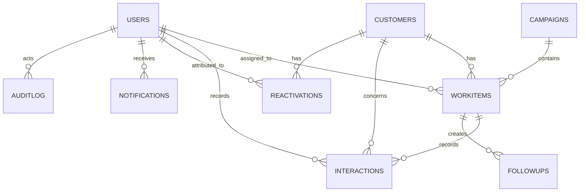

# Data model

Each worksheet is a table. Header names are part of the application contract and should not be renamed without updating the service layer.

| Worksheet | Key | Important relationships | Validation and role |
| --- | --- | --- | --- |
| `Configuration` | `Key` | Read by dashboards and scoring | Numeric controlled values; admin write |
| `Users` | `User ID` | Referenced by work, interactions, follow-ups, reactivations, notifications, audit | Active role in `AGENT`, `TEAM_LEAD`, `EXECUTIVE`, `ADMIN`; salted SHA-256 password hash |
| `Customers` | `Customer ID` | Referenced by work, interactions, follow-ups, reactivations | `Contact Consent=NO` is written on opt-out; `Created At` supports cohort reporting |
| `Campaigns` | `Campaign ID` | Referenced by work items | Only `ACTIVE` campaigns are offered to agents |
| `WorkItems` | `Work Item ID` | Belongs to campaign and customer; optional assignee | State in `QUEUED`, `IN_PROGRESS`, `FOLLOW_UP`, `CLOSED`; expiring lock |
| `Interactions` | `Interaction ID`; unique `Request ID` | Belongs to work item, customer, and agent | Valid outcome, non-negative `mm:ss`, notes at least 3 chars |
| `FollowUps` | `Follow-up ID` | Belongs to work item, customer, owner | Created for callback/answered dispositions when a due time is provided |
| `Reactivations` | `Reactivation ID` | Customer and attributable agent | Only lead/executive/admin can create verified record; one verified record/customer by service rule |
| `Notifications` | `Notification ID` | Recipient is a user | Agent can read/mark only their own notifications |
| `AuditLog` | `Audit ID` | Actor and entity references | Application appends event metadata, no end-user edit screen |
| `Lookups` | `(List, Value)` | Outcome and configurable dropdown source | `Active` controls permitted list maintenance |

## Cardinality

## Data handling

The seed routine creates only fictional records. User-entered notes are not trusted: server code removes angle brackets and control characters, limits length, and UI code renders data as text. Phone values are operational display data, not a recommendation to store sensitive information without appropriate policy and legal review.

