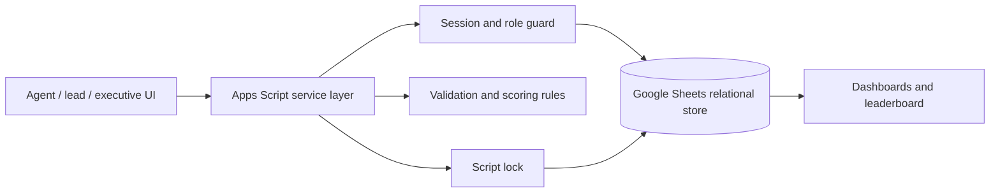
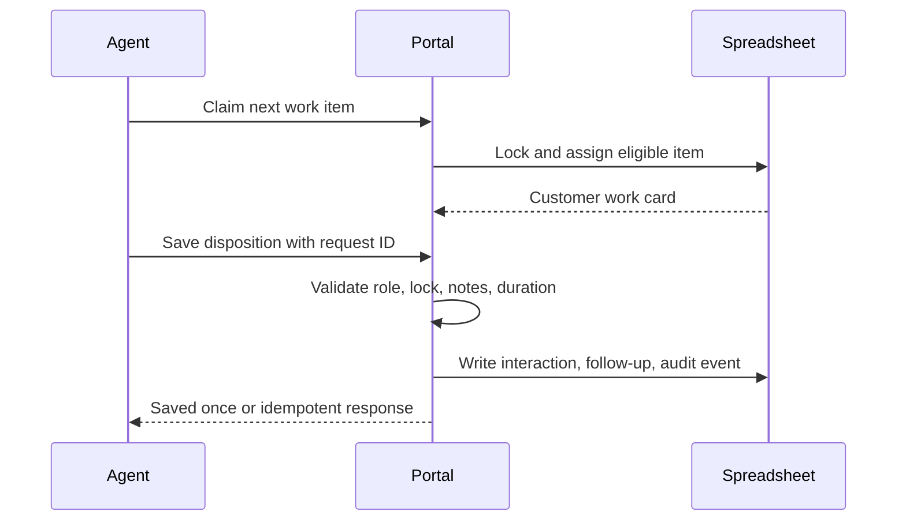

# Customer Engagement Workflow Portal

**NexaFlow** is the synthetic demo name used inside this clean-room Google Apps Script portfolio project. The application itself is a **Customer Engagement Workflow Portal**: a role-aware system for managing customer re-engagement work from queue assignment through interaction capture, follow-up, verification, and executive reporting.

Manual outreach campaigns often fracture across spreadsheets, call notes, supervisor updates, and after-the-fact reports. This project turns that fragmented process into an auditable workflow while keeping Google Sheets as a transparent operational data store. It is deliberately company-neutral and uses only fictional records.

## What it demonstrates

- Full-stack Apps Script development using Sheets, HTML, CSS, and JavaScript
- Role-based workflows for agents, team leads, executives, and administrators
- Relational spreadsheet data modelling with documented IDs and validation rules
- Idempotent interaction writes, script locks, expiring work claims, and audit logging
- Operational dashboards, configurable scoring, queue prioritization, and rankings
- Secure-by-default portfolio practices: fictional data, no secrets, no production links

Automation is used for routing, validation, reporting, and reminders. NexaFlow does not claim to use AI for decision-making or profiling.

## Portal workspaces

The interface is designed around distinct operational responsibilities rather than giving every user the same screen.

| Workspace | Purpose |
| --- | --- |
| Agent | Claims eligible outreach work, records interaction outcomes, and manages assigned follow-ups. Customer records are not broadly browsable. |
| Team lead | Coordinates campaigns, monitors queues, reviews team operations, and accesses permitted customer records. |
| Executive | Reviews aggregate lifecycle, outcome, cohort, locale, and activity charts; uses the executive discussion space; and reviews the independently verified reactivation register. Executives do not use calling workflows. |
| Administrator | Manages configuration, governance, readiness, and workspace administration. Administrators do not use calling, coordination, or executive-reporting workflows. |

The portfolio demo includes a persona switcher so reviewers can inspect each workspace without repeatedly entering credentials. All accounts and data are synthetic.

## Repository layout

| Path | Purpose |
| --- | --- |
| `appsscript/` | Google Apps Script server modules, responsive portal UI, shared styles, and leaderboard UI |
| `synthetic-data/` | Synthetic-data notes and setup source |
| `tests/` | Local pure-rule and service-contract tests |
| `docs/` | Architecture, data, security, feature, test, and portfolio documentation |

## Quick start

1. Create a new blank Google Sheet owned by you.
2. Create a standalone Apps Script project bound to that sheet and copy every file from `appsscript/`, preserving its filename. In particular, `index.html` includes the shared `styles.html` partial, and `operations.gs` supplies the deeper reporting and administration services. `clasp` may be used if preferred.
3. Run `setupNexaFlowSyntheticDatabase` once and authorize only the requested current-spreadsheet scopes.
4. Deploy as a web app only for testing. Start with **Only myself** access; changing to a wider audience is a deliberate deployment decision, not a repository default.
5. Sign in as `agent@nexaflow.example` using `ChangeMe!2027`. These are fictional portfolio records in the synthetic workbook only.

Run local checks with `npm test`. Google Apps Script integration tests are described in [TESTING.md](TESTING.md).

## Architecture and operating flow

## Responsible portfolio statement

The original workplace project was reviewed only to understand categories of functionality. NexaFlow is an independently implemented reconstruction. It contains no employer source code, proprietary metrics, production configuration, production contacts, secrets, or deployment targets. AI-assisted development was used for drafting and review, while the author remains responsible for validation, architecture, and claims made in this repository.

See [FEATURES.md](FEATURES.md), [ARCHITECTURE.md](ARCHITECTURE.md), [DATA_MODEL.md](DATA_MODEL.md), [SECURITY.md](SECURITY.md), and [TESTING.md](TESTING.md).

